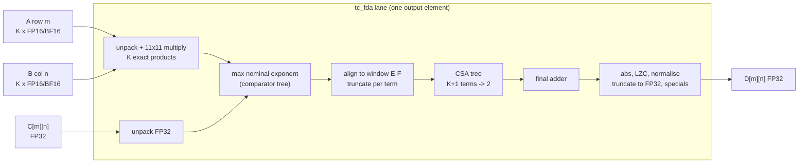

# Microarchitecture

## Block level

`tc_mma_core` computes `D[MxN] = A[MxK] * B[KxN] + C[MxN]` with `M*N`
fused dot-add (FDA) lanes of `K` products each. Both shapes used in this
project have 64 multipliers, the size of one Volta tensor core:

| Shape | M x N x K | Lanes | Products per lane | Matches |
|---|---|---|---|---|
| Ampere-style (default) | 4 x 2 x 8 | 8 | 8 | RTX 30xx numerics hypothesis (8-term block FMA) |
| Volta-style | 4 x 4 x 4 | 16 | 4 | classic 4x4x4 tensor core |

A 16-deep reduction (one WMMA `m16n16k16` element) takes `16 / K` issues, each
feeding the previous `D` back as `C`, which is the `(c + T1) + T2` chaining
order. `tb/verilator/tb_mma.cpp` drives exactly this sequence.

## Lane datapath (`rtl/tc_fda.sv`)

| Step | Logic | Width (K=8, F=24) |
|---|---|---|
| Unpack | `tc_unpack16` per operand: sign, 11-bit significand (BF16 gets 3 zero bits), 12-bit signed exponent, zero/inf/NaN flags. Subnormals kept. | |
| Multiply | `tc_mul`: one 11x11 array shared by FP16 and BF16 (`SHARED_MUL=1`), or 11x11 plus 8x8 with a mux (`SHARED_MUL=0`) | 22-bit product |
| Term widening | product `<< (F-20)`, accumulator significand `<< (F-23)` | `TW = F+2 = 26` |
| Exponent max | balanced comparator tree over non-zero terms, in offset-binary so the compare is unsigned | 12 bits |
| Alignment | `term >> (E - e_i)`, bits shifted out dropped (no guard/sticky), then two's complement by sign | `SW = 32` |
| Reduction | `tc_csa_tree`: recursive 3:2 compressor tree, 9 operands to 2 | 32 |
| Carry-propagate add | one adder | 32 |
| Normalise | absolute value, `tc_lzc`, left shift, take 24 bits (truncation = RZ) | |
| Pack | normal / subnormal / overflow-to-inf, then NaN, inf and -0 overrides | 32 |

`SW` holds the worst-case sum: 9 terms below `2^26` need 30 bits plus sign.
The extra margin bit is deliberate.

## Pipeline

`NUM_STAGES` (1 to 6) is the latency. The output register always exists. The
remaining registers are placed at five candidate cuts:

| NUM_STAGES | C1 after multiply | C2 after exp max | C3 after align | C4 after CSA | C5 after adder |
|---|---|---|---|---|---|
| 1 | | | | | |
| 2 | | | x | | |
| 3 | x | | | x | |
| 4 | x | | x | | x |
| 5 | x | x | x | | x |
| 6 | x | x | x | x | x |

The pipeline has a valid bit and no stall input: an issue every cycle is
accepted, so throughput is one MMA per cycle. `syn/yosys/results.md` gives
the logic depth for each setting. Past 5 stages the unpack + multiply stage
is the critical path, so going deeper would need a cut inside the multiplier
(for example after Booth partial-product generation).

## Interface (`tc_mma_core`)

| Port | Width | Meaning |
|---|---|---|
| `in_valid` | 1 | issue an operation this cycle |
| `in_fmt` | 1 | 0 = FP16, 1 = BF16 inputs |
| `a_i` | M*K*16 | `A[m][k]` at bits `((m*K)+k)*16` |
| `b_i` | K*N*16 | `B[k][n]` at bits `((k*N)+n)*16` |
| `c_i` | M*N*32 | `C[m][n]` at bits `((m*N)+n)*32` |
| `out_valid` | 1 | `NUM_STAGES` cycles after `in_valid` |
| `d_o` | M*N*32 | `D[m][n]`, same packing as `c_i` |

## Parameters

| Parameter | Default | Notes |
|---|---|---|
| `M`, `N`, `K` | 4, 2, 8 | shape (`tc_mma_core`); `K` also on `tc_fda` |
| `F` | 24 | alignment window (fractional bits below E); must be >= 23 |
| `NUM_STAGES` | 3 | 1..6 |
| `SHARED_MUL` | 1 | 0 = separate BF16 multiplier (area comparison) |
| `ENABLE_BF16` | 1 | 0 = FP16-only lane (area baseline) |

The RTL implements the default numerics of `docs/01_numerics_spec.md`. The
model-only alternatives (`align_ref=actual`, `trunc=floor`, `round=rne`,
`zero_in_emax=1`, `overflow_to_inf=0`) are not in the RTL. If the GPU
characterisation selects one of them, these are the places to change:

* `zero_in_emax`: drop the `~s1_zero` validity in the exponent tree.
* `trunc=floor`: add a per-term "bits lost" OR-reduce in stage 2 and subtract 1 for negative terms.
* `round=rne`: keep guard/round/sticky from `s5_norm` and add an incrementer before packing.
